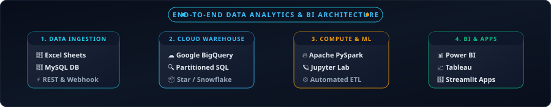
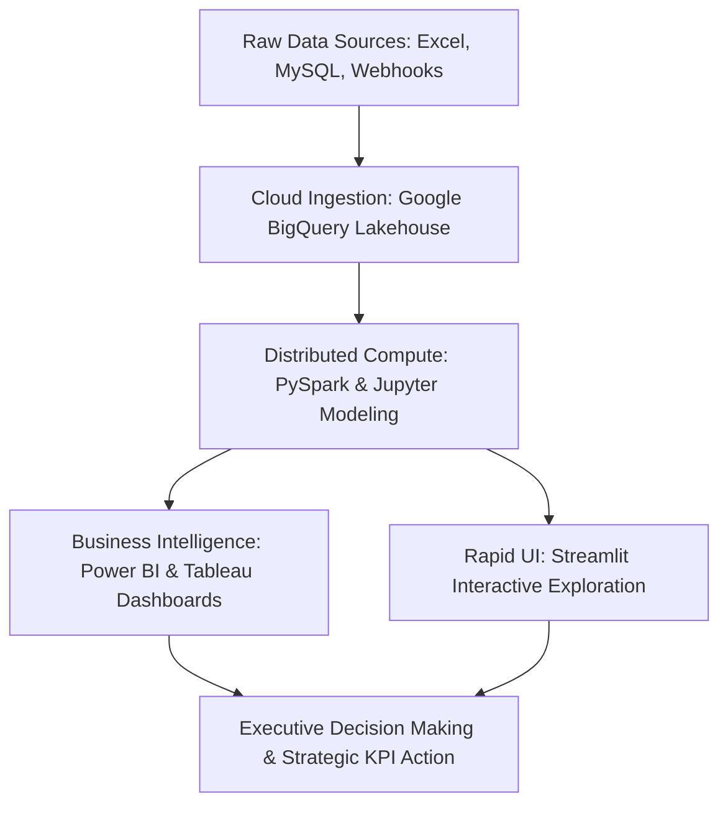

<div align="center">

  <!-- NATIVE ANIMATED CYBER BANNER -->
  

  <br/>

  <!-- ANIMATED TYPING SVG -->
  

  <br/>

  <!-- TECH BADGES -->
  <p align="center">
    
    
    
    
    
    
  </p>

</div>


### 🌟 System Overview

**Personal Professional Portfolio** is an architectural template designed to serve as the definitive digital identity for software engineers, data scientists, and analytics professionals. It structures projects, enterprise BI dashboards, real-time data metrics, and verified credentials into an interactive, visually stunning cyber showcase.

---

### 🛠️ Interactive Tech Stack & Capabilities

<div align="center">

#### 📊 Data Analytics, Business Intelligence & Big Data
<p align="center">
  <!-- Native Animated Dark Theme Badges matching SkillIcons styling -->
  
</p>
<p align="center">
  <a href="https://powerbi.microsoft.com/" target="_blank">
    
  </a>
  <a href="https://www.tableau.com/" target="_blank">
    
  </a>
  <a href="https://jupyter.org/" target="_blank">
    
  </a>
  <a href="https://streamlit.io/" target="_blank">
    
  </a>
  <a href="https://www.microsoft.com/excel" target="_blank">
    
  </a>
  <a href="https://www.mysql.com/" target="_blank">
    
  </a>
  <a href="https://cloud.google.com/bigquery" target="_blank">
    
  </a>
  <a href="https://spark.apache.org/" target="_blank">
    
  </a>
</p>

#### 🧠 Artificial Intelligence & Data Science
<p align="center">
  <a href="https://skillicons.dev">
    
  </a>
</p>

#### 🌐 Full-Stack & Modern Web
<p align="center">
  <a href="https://skillicons.dev">
    
  </a>
</p>

#### ⚙️ Backend, Databases & Cloud
<p align="center">
  <a href="https://skillicons.dev">
    
  </a>
</p>

#### 🔧 Developer Tools, DevOps & Mobile
<p align="center">
  <a href="https://skillicons.dev">
    
  </a>
</p>

</div>

<br/>

<!-- ANIMATED DATA PIPELINE ARCHITECTURE FLOW -->
<div align="center">
  
</div>

<br/>

<!-- ANIMATED TERMINAL TELEMETRY -->
<div align="center">
  
</div>


### 🔬 Operational Architecture & Data Pipeline Flow




### 🚀 Key Capabilities & Features

- **📊 Comprehensive Data Analytics:** Production-grade BI modeling with **Power BI**, **Tableau**, **Google BigQuery**, **PySpark**, **MySQL**, and **Excel**.
- **⚡ High-Speed Static Generation:** Blazing-fast load times with optimized assets and zero layout shift.
- **📱 Full Device Responsiveness:** Tailored experiences across smartphones, tablets, and ultrawide displays.
- **🎨 Dark / Cyber Aesthetic:** Neon gradients, animated SVG laser dividers, and smooth hover micro-interactions.
- **📄 One-Click ATS Resume Download:** Direct link to verified PDF resume for instant recruiter review.


### ⚡ Quickstart & Execution

```bash
# 1. Clone & enter
git clone https://github.com/Akshay-Notfound/Personal-Professional-Portfolio.git
cd Personal-Professional-Portfolio

# 2. Customize data/site.ts and deploy on Vercel!
npm install
npm run dev
```


### 👤 Author & Architecture

**Akshay Shivaji Rathod**  
*Data & AI Engineer • Full-Stack Architect*  
* 🌐 **Portfolio:** [akshay-notfound.vercel.app](https://akshay-notfound.vercel.app)  
* 💼 **LinkedIn:** [linkedin.com/in/akshay-rathod-aaab52206](https://www.linkedin.com/in/akshay-rathod-aaab52206/)  
* 🐙 **GitHub:** [@Akshay-Notfound](https://github.com/Akshay-Notfound)  

---

<div align="center">
  <sub>Licensed under the MIT License. Designed for scalability, data intelligence, and performance.</sub>
  <br/><br/>
  <!-- FOOTER WAVE -->
  
</div>
