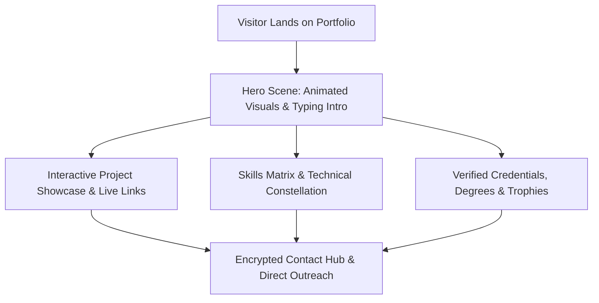

<div align="center">

  <!-- NATIVE ANIMATED CYBER BANNER -->
  

  <br/>

  <!-- ANIMATED TYPING SVG -->
  

  <br/>

  <!-- TECH BADGES -->
  <p align="center">
    
    
    
    
    
  </p>

</div>

---

### 🌟 System Overview

**Personal Professional Portfolio** is an architectural template designed to serve as the definitive digital identity for software engineers, data scientists, and AI practitioners. It structures projects, skills, real-time metrics, and verified certifications into an interactive, visually stunning web showcase.

---

### 🔬 Operational Architecture & Data Pipeline Flow



---

### 🚀 Key Capabilities & Features

- **⚡ High-Speed Static Generation:** Blazing-fast load times with optimized assets and zero layout shift.
- **📱 Full Device Responsiveness:** Tailored experiences across smartphones, tablets, and ultrawide displays.
- **🎨 Dark / Cyber Aesthetic:** Neon gradients, clean card borders, and smooth hover micro-interactions.
- **📄 One-Click ATS Resume Download:** Direct link to verified PDF resume for instant recruiter review.

---

### ⚡ Quickstart & Execution

```bash
# 1. Clone & enter
git clone https://github.com/Akshay-Notfound/Personal-Professional-Portfolio.git
cd Personal-Professional-Portfolio

# 2. Customize data/site.ts and deploy on Vercel!
```

---

### 👤 Author & Architecture

**Akshay Shivaji Rathod**  
*Data & AI Engineer*  
* 🌐 **Portfolio:** [akshay-notfound.vercel.app](https://akshay-notfound.vercel.app)  
* 💼 **LinkedIn:** [linkedin.com/in/akshay-rathod-aaab52206](https://www.linkedin.com/in/akshay-rathod-aaab52206/)  
* 🐙 **GitHub:** [@Akshay-Notfound](https://github.com/Akshay-Notfound)  

---

<div align="center">
  <sub>Licensed under the MIT License. Designed for scalability, intelligence, and performance.</sub>
</div>
